<div align="center">

# Slat_e

**Шесть настольных программ в одном стиле: «жидкое стекло» в духе macOS.**<br>
Фоторедактор, презентации, текстовый редактор, таблицы, видеомонтаж и лаунчер Minecraft.<br>
Работают без интернета, ИИ — локальный, через Ollama.

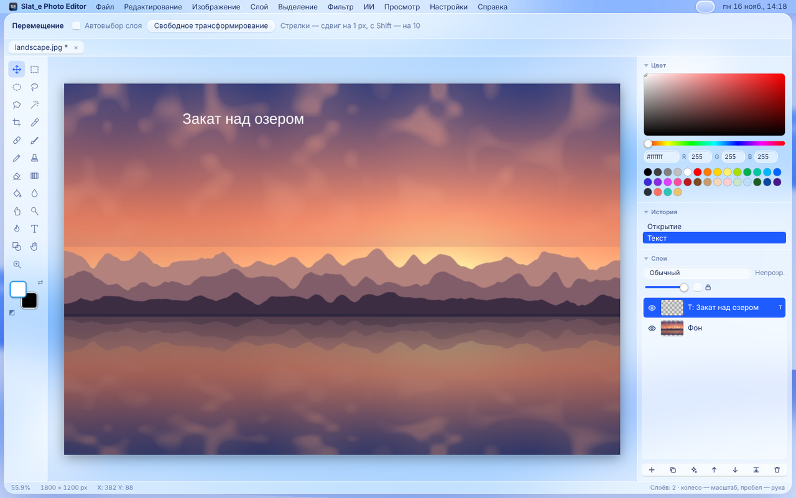

</div>

---

## Содержание

- [Программы](#программы)
- [Что общего у всех программ](#что-общего-у-всех-программ)
- [SE — Slat_e Photo Editor](#se--slat_e-photo-editor)
- [SS — Slat_e Slides](#ss--slat_e-slides)
- [ST — Slat_e Text Editor](#st--slat_e-text-editor)
- [SX — Slat_e Sheets](#sx--slat_e-sheets)
- [SV — Slat_e Video Editor](#sv--slat_e-video-editor)
- [SM — Slat_e Minecraft Launcher](#sm--slat_e-minecraft-launcher)
- [Как это устроено](#как-это-устроено)
- [Запуск и требования](#запуск-и-требования)
- [Сборка из исходников](#сборка-из-исходников)
- [Структура репозитория](#структура-репозитория)

---

## Программы

| | Программа | Для чего | Основные файлы |
|---|---|---|---|
| 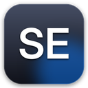 | **[SE — Photo Editor](#se--slat_e-photo-editor)** | Редактирование фото, слои, RAW, ИИ-заливка | PNG, JPEG, WebP, GIF, BMP, SVG, AVIF, ICO, RAW |
|  | **[SS — Slides](#ss--slat_e-slides)** | Презентации, морфинг, ИИ-слайды | PPTX, PPT |
|  | **[ST — Text Editor](#st--slat_e-text-editor)** | Документы, шаблоны, ИИ-помощник | DOCX, HTML, TXT, Markdown |
|  | **[SX — Sheets](#sx--slat_e-sheets)** | Таблицы, формулы, диаграммы | XLSX, CSV, TSV |
| 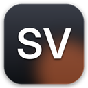 | **[SV — Video Editor](#sv--slat_e-video-editor)** | Видеомонтаж с эффектами и цветокоррекцией | MP4, MOV, MKV, WebM и др. |
|  | **[SM — Minecraft Launcher](#sm--slat_e-minecraft-launcher)** | Сборки, моды, модпаки | — |

---

## Что общего у всех программ

| | |
|---|---|
| **Единый стиль** | «Жидкое стекло» с плавными анимациями. Классический вид без стекла включается в меню оформления. Светлая и тёмная тема переключаются кнопкой в правом верхнем углу. |
| **Меню оформления** | Открывается кликом по логотипу. Сила стекла, анимации, цвет фона и обои: картинка, GIF или видео, с настройкой громкости и затемнения. |
| **Без интернета** | Шрифты, иконки и весь код встроены в программу. Интернет нужен только там, где он нужен по смыслу: загрузка версий Minecraft и модов в SM. |
| **Локальный ИИ** | Подключается к вашему [Ollama](https://ollama.com). Модель выбирается в «Настройках ИИ». Запросы не уходят за пределы компьютера. |
| **Один файл** | Каждая программа — один HTML-файл внутри небольшого лаунчера на Go. Устанавливать ничего не нужно. |
| **Открытие файлов** | Лаунчеры принимают файлы из командной строки, поэтому работает «Открыть с помощью» и перетаскивание файла на значок. |
| **Русский интерфейс** | Всё на русском, включая формулы в SX. |

---

## SE — Slat_e Photo Editor


Редактор растровых изображений со слоями, ориентированный на привычную раскладку инструментов Photoshop. Подходит для ретуши, коллажей, подписей и цветокоррекции.

<p align="center">
  <a href="docs/img/se-main.png"></a>
</p>

<p align="center">
  <a href="docs/img/se-curves.png">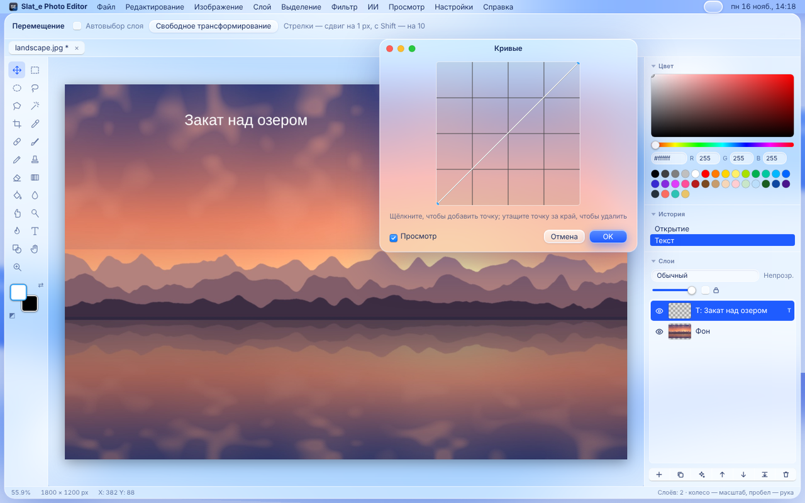</a>
  <a href="docs/img/se-filters.png">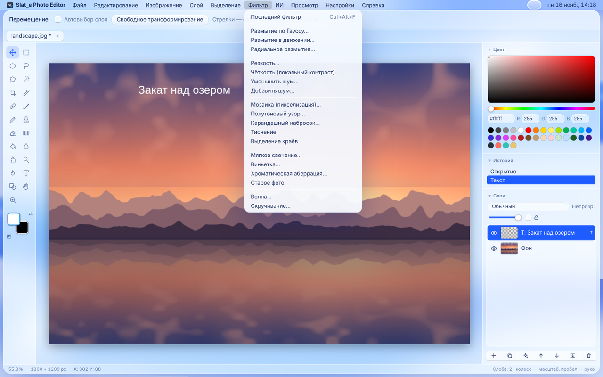</a>
  <a href="docs/img/se-dark.png">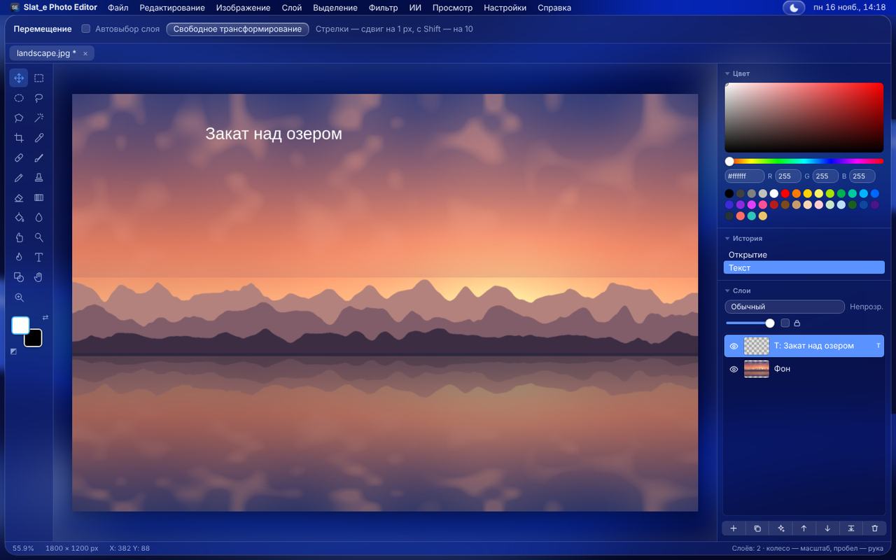</a>
</p>

**Возможности**

- **23 инструмента:** перемещение, прямоугольная и овальная области, лассо и прямолинейное лассо, волшебная палочка, рамка (кадрирование), пипетка, точечная восстанавливающая кисть, кисть, карандаш, штамп, ластик, градиент, заливка, размытие, палец, осветлитель, затемнитель, текст, фигуры, рука, масштаб.
- **Слои:** 17 режимов наложения, непрозрачность, блокировка, стили слоя (тень, обводка, свечение), текстовые слои с растрировкой, объединение и сведение, история действий.
- **Цветокоррекция (18 команд):** яркость и контраст, уровни, кривые, экспозиция, сочность, цветовой тон и насыщенность, цветовой баланс, температура и оттенок, тени и света, чёрно-белое, фотофильтр, порог, постеризация, сепия, инверсия, автоконтраст и автоцвет.
- **Фильтры (18):** размытие по Гауссу, в движении и радиальное, резкость, чёткость, шумоподавление и добавление шума, мозаика, полутона, карандашный набросок, тиснение, выделение краёв, мягкое свечение, виньетка, хроматическая аберрация, старое фото, волна, скручивание.
- **Выделение:** растушёвка, расширение и сжатие, инверсия, заливка с учётом содержимого, обводка выделения, удаление однотонного фона.
- **RAW:** открытие и проявка файлов 30 форматов (DNG, CR2, CR3, NEF, ARW, ORF, RW2, RAF, PEF и другие) прямо в программе, без внешних конвертеров.
- **ИИ через Ollama:** генеративная заливка (замена объекта по описанию) и удаление объекта. Модель, которая рисует, выбирается в настройках.

**Файлы:** открывает PNG, JPEG, WebP, GIF, BMP, SVG, AVIF, ICO и RAW; экспортирует PNG, JPEG, WebP; проект со слоями сохраняется в собственном формате `.kadr`.

---

## SS — Slat_e Slides


Редактор презентаций, работающий с настоящими файлами PowerPoint. Главное отличие: переход «Морфинг» и создание красивых слайдов с помощью локального ИИ.

<p align="center">
  <a href="docs/img/ss-chart.png">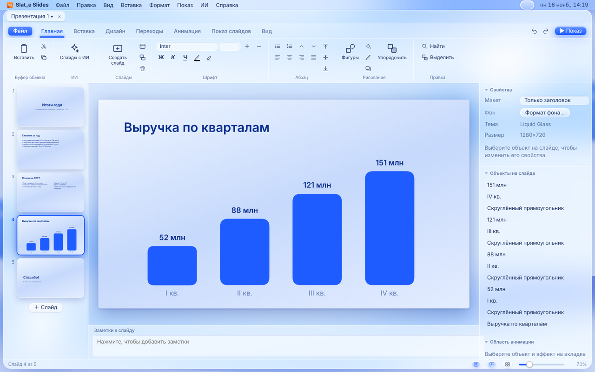</a>
</p>

<p align="center">
  <a href="docs/img/ss-start.png">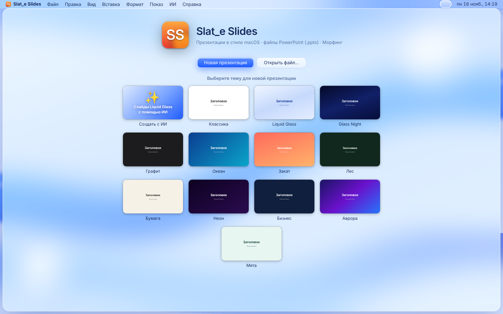</a>
  <a href="docs/img/ss-content.png">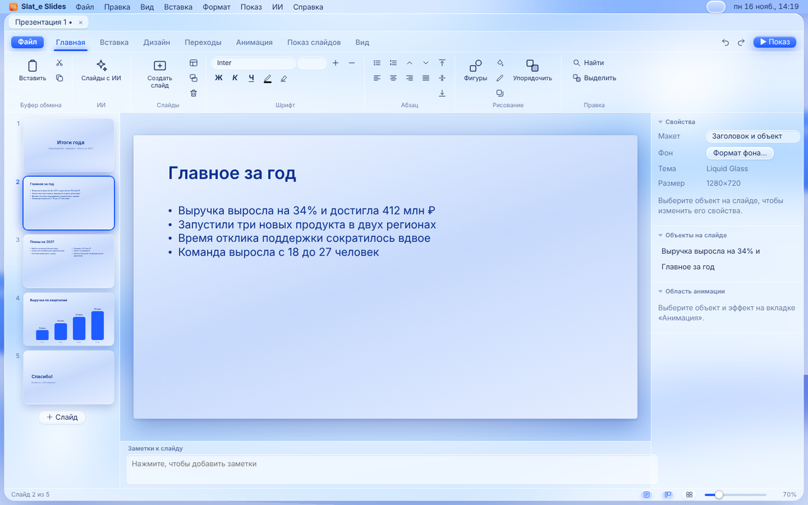</a>
  <a href="docs/img/ss-sorter.png">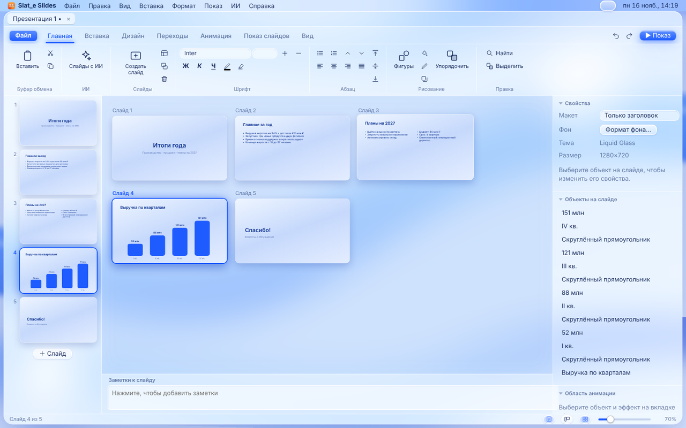</a>
</p>

**Возможности**

- **12 тем** для новой презентации: Классика, Liquid Glass, Glass Night, Графит, Океан, Закат, Лес, Бумага, Неон, Бизнес, Аврора, Мята.
- **8 макетов слайда:** титульный, заголовок и объект, раздел, два объекта, сравнение, только заголовок, пустой, рисунок с подписью.
- **Переходы (11):** выцветание, сдвиг, волна, наплыв, открытие, разделение, масштаб, растворение, переворот, **морфинг**, стекло.
- **Анимация объектов:** 8 эффектов входа, 5 акцентов, 6 выходов, область анимации.
- **Вставка:** надписи, фигуры, рисунки, таблицы, символы, дата и номер слайда.
- **Вид:** обычный режим, сортировщик слайдов, заметки докладчика, сетка и привязка к направляющим.
- **Показ слайдов** с начала или с текущего слайда, предпросмотр перехода и анимации.
- **ИИ через Ollama:** создание целой презентации по теме, создание отдельного слайда, оформление текущего слайда в стиле Liquid Glass.

**Файлы:** открывает `.pptx`, `.potx` и старые `.ppt` (97–2003); сохраняет в `.pptx` и `.ppt`; печать и экспорт в PDF.

---

## ST — Slat_e Text Editor


Текстовый редактор в духе Word: страницы, стили, таблицы, навигация по заголовкам и файлы `.docx`.

<p align="center">
  <a href="docs/img/st-main.png">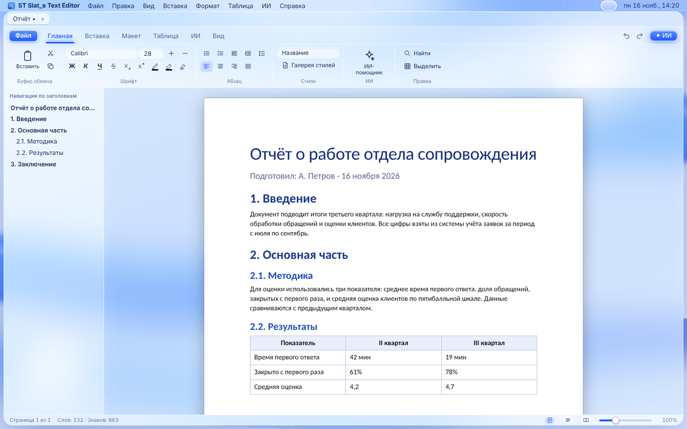</a>
</p>

<p align="center">
  <a href="docs/img/st-start.png">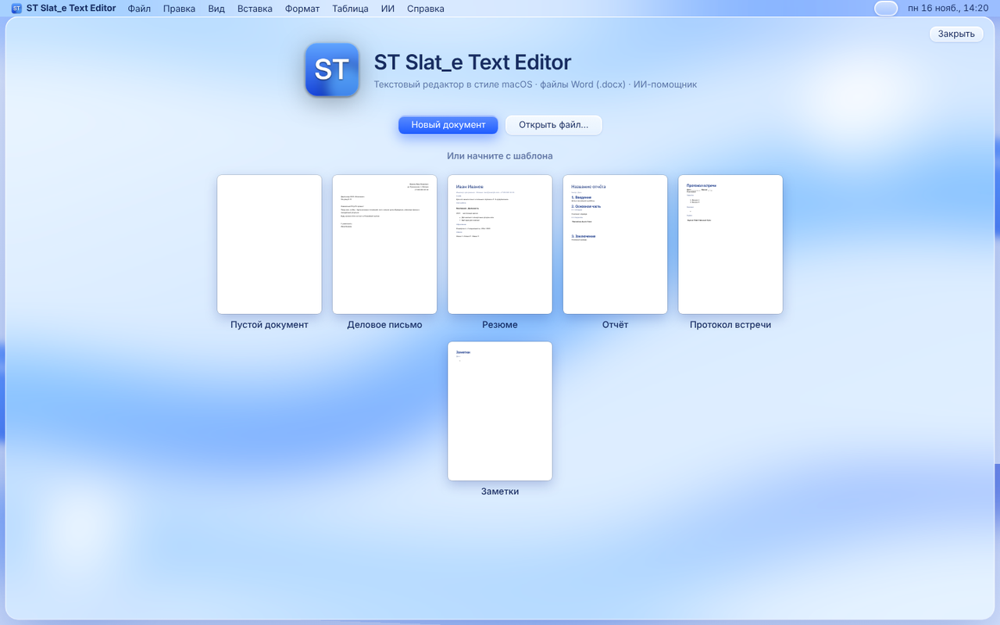</a>
  <a href="docs/img/st-aimenu.png">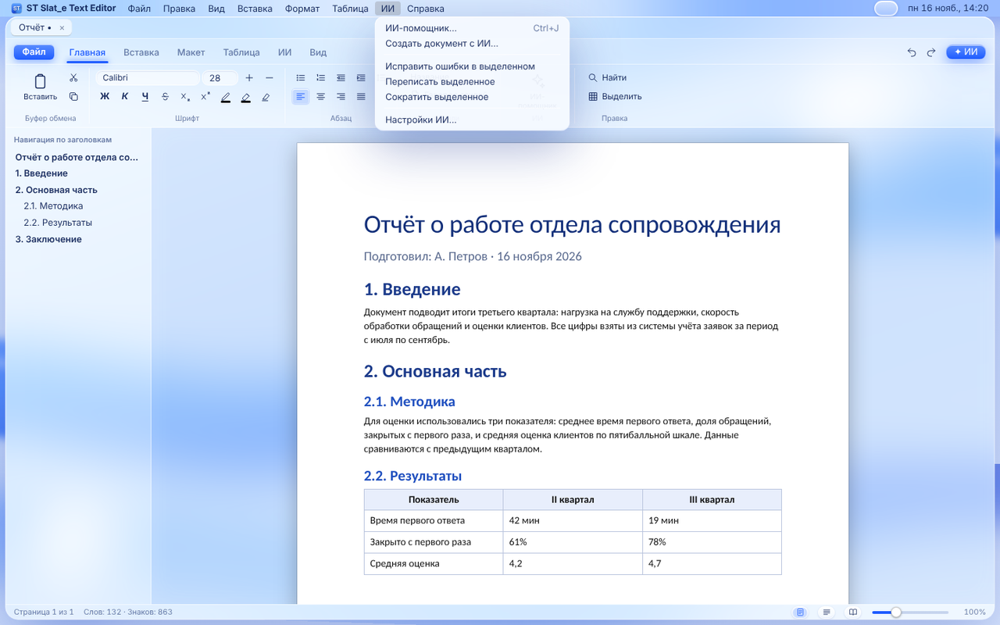</a>
</p>

**Возможности**

- **Шаблоны:** пустой документ, деловое письмо, резюме, отчёт, протокол встречи, заметки.
- **Форматирование:** шрифты и размеры, жирный, курсив, подчёркивание, зачёркивание, верхний и нижний индексы, цвет текста и выделение, списки, отступы, выравнивание, межстрочный интервал, галерея стилей и заголовки 1–3.
- **Вставка:** таблицы с правкой строк и столбцов, изображения, ссылки, горизонтальная линия, разрыв страницы, символы, дата.
- **Навигация по заголовкам** слева, счётчик слов и знаков, поиск и замена.
- **Режимы просмотра:** разметка страницы, непрерывный режим, режим чтения, тёмная страница.
- **ИИ через Ollama:** помощник в боковой панели, создание документа по описанию, исправление ошибок, переписывание и сокращение выделенного текста.

**Файлы:** открывает `.docx`, `.dotx`, `.html`, `.txt`, `.md`; сохраняет `.docx`, `.html`, `.txt`, `.md`; PDF через печать.

---

## SX — Slat_e Sheets


Табличный редактор в духе Excel: настоящие файлы `.xlsx`, формулы на русском и английском, диаграммы и условное форматирование.

<p align="center">
  <a href="docs/img/sx-budget.png">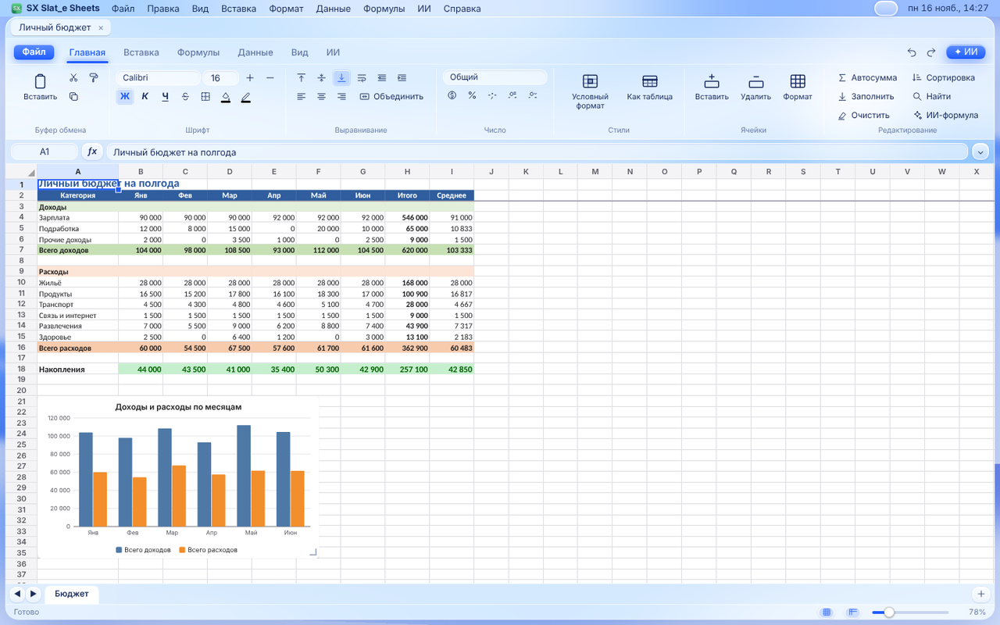</a>
</p>

<p align="center">
  <a href="docs/img/sx-start.png">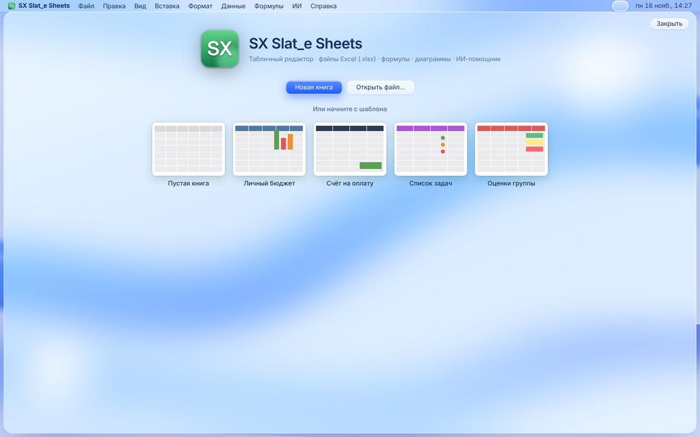</a>
  <a href="docs/img/sx-ai.png">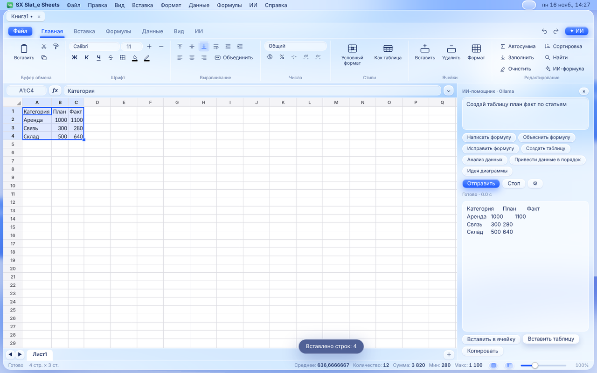</a>
</p>

**Возможности**

- **Более 270 функций** с русскими и английскими именами: `СУММ`/`SUM`, `ЕСЛИ`/`IF`, `ВПР`/`VLOOKUP` и т. д. Именованные диапазоны и динамические массивы.
- **Формат ячеек:** числа, валюты, проценты, даты, шрифты, заливка, границы, перенос по словам, объединение ячеек, автоширина и автовысота.
- **Диаграммы (7 типов):** гистограмма, линейчатая, график, с областями, круговая, кольцевая, точечная. Сохраняются в PNG и SVG.
- **Условное форматирование:** значения, текст, первые и последние, выше и ниже среднего, повторы, цветовые шкалы, гистограммы, значки.
- **Данные:** сортировка и фильтры, проверка данных с выпадающими списками, удаление дубликатов, текст по столбцам.
- **Прочее:** закрепление областей, комментарии, гиперссылки, стили «Как таблица», поиск и замена, строка статуса с суммой, средним и количеством выделенного.
- **Шаблоны:** личный бюджет, счёт на оплату, список задач, оценки группы.
- **ИИ через Ollama:** написать формулу по описанию, объяснить и исправить формулу, создать таблицу, проанализировать выделенные данные, подсказать диаграмму.

**Файлы:** открывает и сохраняет `.xlsx` (стили, формулы, диаграммы, условное форматирование, проверка данных, закрепление, комментарии); `.csv` и `.tsv` — импорт и экспорт; экспорт в HTML и PDF.

> Не поддерживаются: сводные таблицы, вставка картинок в ячейки, макросы. Формулы с «умными» ссылками на таблицы Excel (`Таблица1[Столбец]`) при открытии превращаются в значения.

---

## SV — Slat_e Video Editor


Видеоредактор с таймлайном, эффектами, переходами, текстом и цветокоррекцией. Монтаж идёт в окне программы, видео рендерится на видеокарте через WebGL.

<p align="center">
  <a href="docs/img/sv-main.png">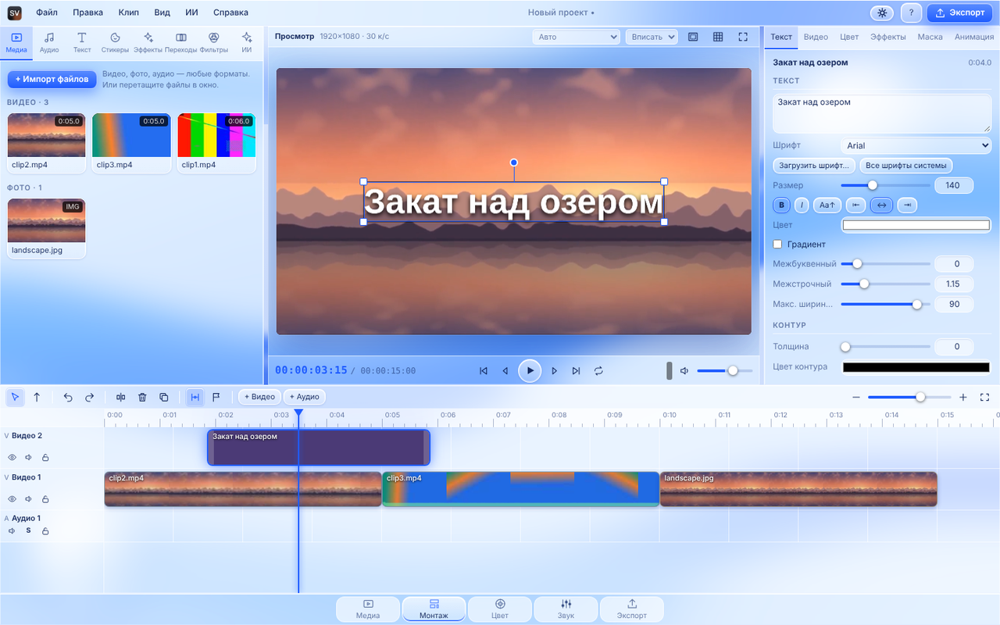</a>
</p>

<p align="center">
  <a href="docs/img/sv-effects.png">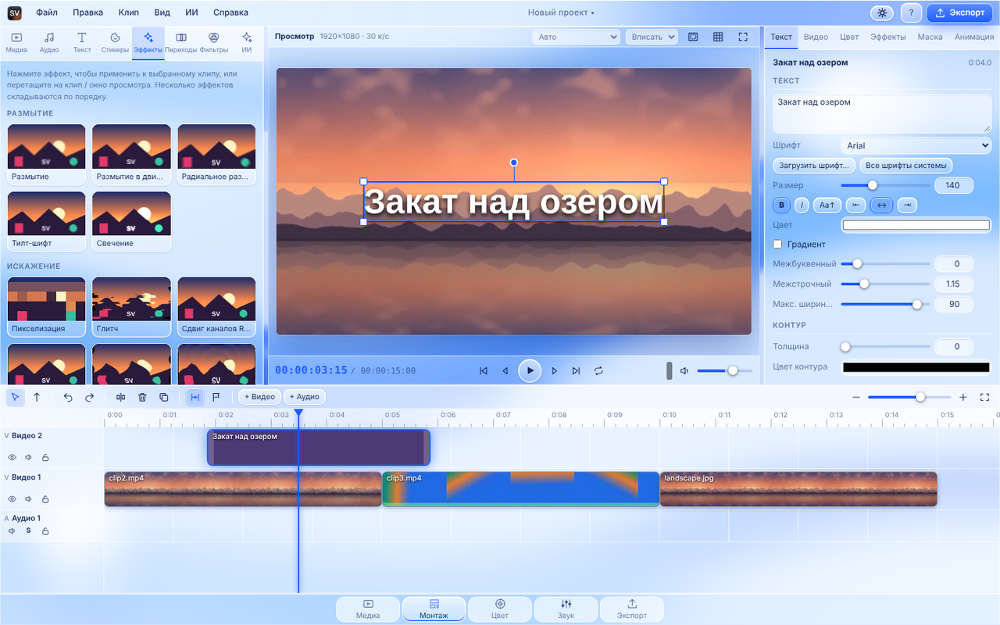</a>
  <a href="docs/img/sv-color.png">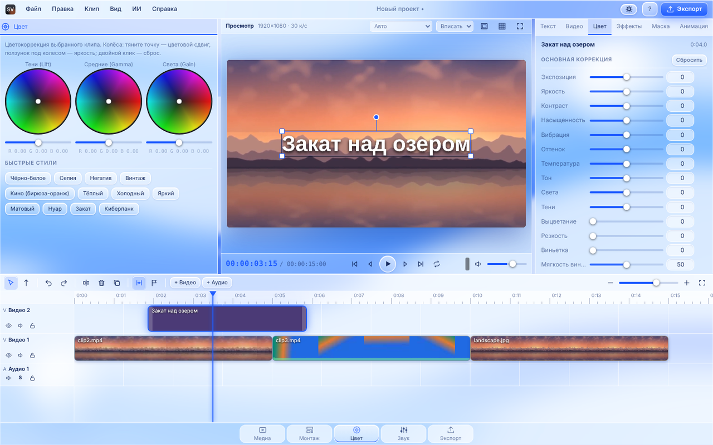</a>
  <a href="docs/img/sv-export.png">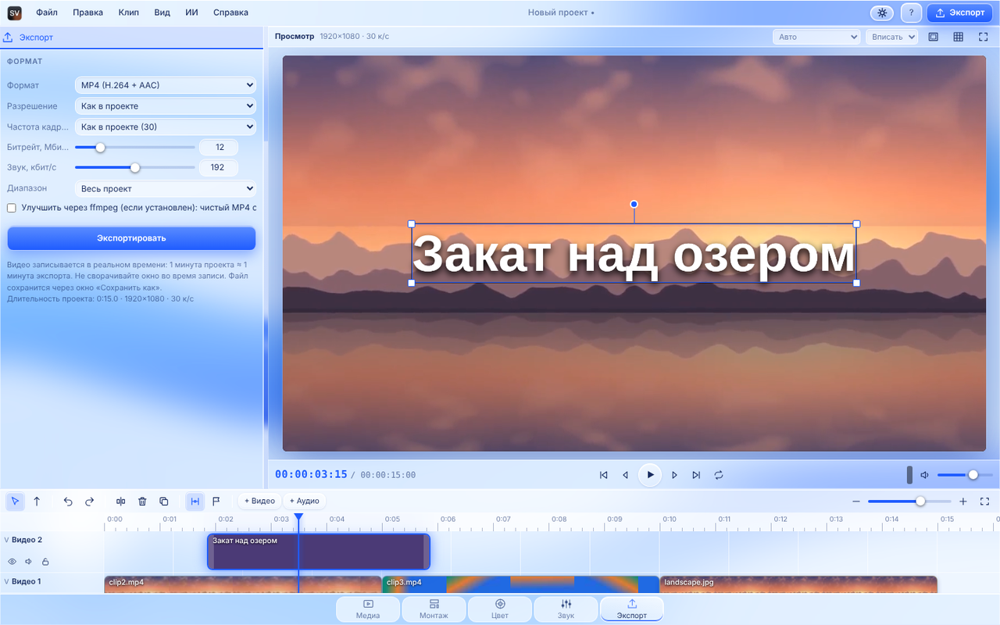</a>
</p>

**Возможности**

- **Таймлайн:** несколько видеодорожек и аудиодорожек, разделение, обрезка по указателю, скорость, стоп-кадр, отделение звука, корректирующие слои, маркеры, ключевые кадры свойств.
- **Свойства клипа:** позиция, масштаб, поворот, отражение, непрозрачность, режимы наложения, обрезка кадра, маски, анимация.
- **Эффекты (30+):** размытия, свечение, пикселизация, глитч, сдвиг каналов, хроматическая аберрация, искажения (волна, рябь, вихрь, выпуклость, рыбий глаз), зеркало, калейдоскоп и другие. Несколько эффектов складываются по порядку.
- **Переходы (35+):** наплыв, через чёрный и белый, шторки, жалюзи, фигуры и другие.
- **Фильтры и цвет:** 19 цветовых стилей (кино, винтаж, нуар, киберпанк, тепловизор и др.), три цветовых колеса (тени, средние тона, света), экспозиция, контраст, насыщенность, температура, тон, виньетка и другие ползунки.
- **Текст:** готовые стили титров, нижние трети, субтитры, градиентная заливка, контур, свои шрифты; импорт субтитров SRT и VTT. Стикеры и фигуры.
- **Звук:** микшер, громкость по дорожкам, запись с микрофона.
- **ИИ через Ollama:** удаление и замена объекта на фото или в кадре, подбор текста и подписей.
- **RAW:** фото в RAW-форматах открываются так же, как в SE.

**Файлы:** принимает почти любое видео, аудио и изображения (MP4, MOV, MKV, AVI, WebM, WMV, FLV, MPEG, TS, MP3, WAV, FLAC, AAC, OGG, JPG, PNG, WebP, GIF, BMP, TIFF, HEIC и др.). Форматы, которые не читает браузер, конвертируются через [ffmpeg](https://ffmpeg.org), если он установлен. Экспорт: MP4 (H.264 + AAC), WebM (VP9 + Opus), GIF, WAV, кадр в PNG; с ffmpeg можно получить «чистый» MP4. Проекты сохраняются в `.stproj`.

> Видео записывается в реальном времени: минута проекта экспортируется примерно за минуту, и окно на это время нужно держать открытым.

---

## SM — Slat_e Minecraft Launcher


Лаунчер Minecraft Java Edition с отдельными сборками, установкой модов и модпаков. Сам скачивает игру, нужную версию Java и библиотеки.

<p align="center">
  <a href="docs/img/sm-play.png">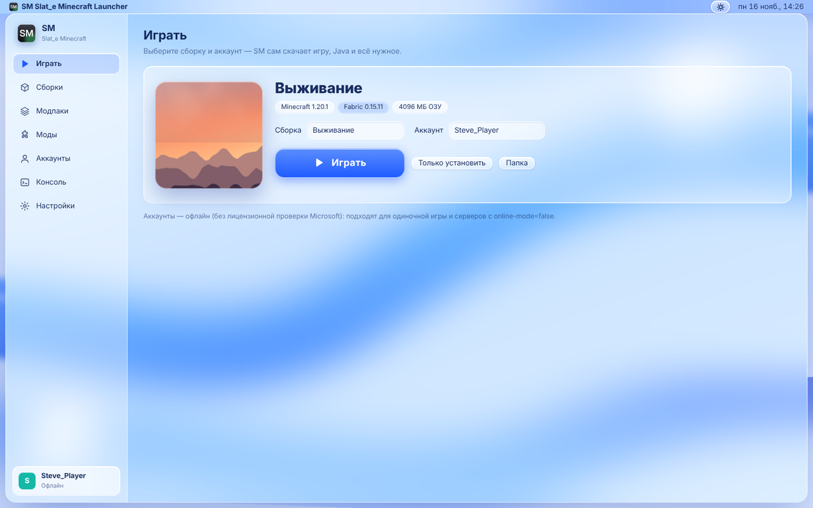</a>
</p>

<p align="center">
  <a href="docs/img/sm-builds.png">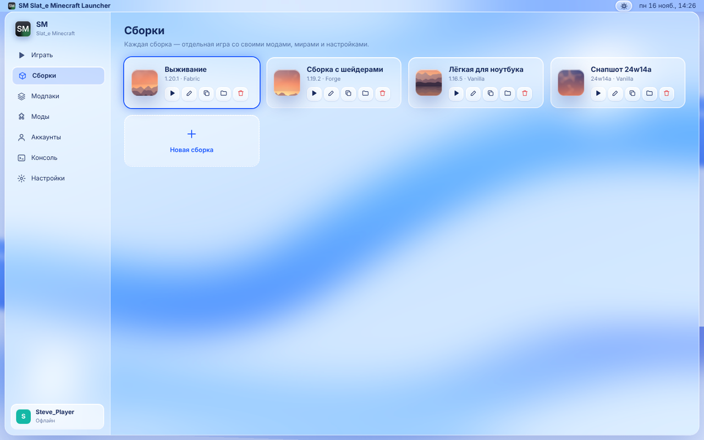</a>
  <a href="docs/img/sm-dark.png">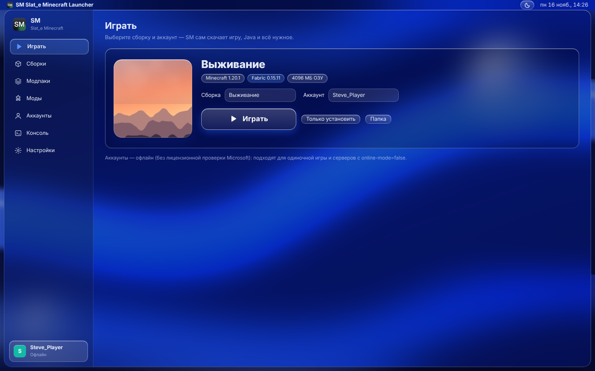</a>
</p>

**Возможности**

- **Сборки:** каждая сборка — отдельная игра со своими модами, мирами и настройками. Можно выбрать папку сборки, дублировать её и удалить вместе со всем содержимым (моды, ресурспаки, миры). Для сборки задаётся своя картинка: выбираете файл и показываете, какая часть фото станет значком.
- **Версии:** релизы, снапшоты, беты (b1.x), альфы (a1.x) и самые первые версии игры.
- **Загрузчики:** Vanilla, Fabric, Forge, NeoForge, Quilt.
- **Моды, ресурспаки и шейдеры** с [Modrinth](https://modrinth.com): поиск, установка вместе с зависимостями, проверка обновлений. Модпаки с Modrinth и CurseForge (для CurseForge нужен собственный API-ключ).
- **Проверка совместимости** (включается в настройках): находит моды не для той версии или загрузчика, дубликаты и конфликты. Необязательные ИИ-подсказки работают через локальный Ollama и помечены значком «ИИ».
- **Аккаунты:** офлайн-аккаунты (для одиночной игры и серверов с `online-mode=false`).
- **Настройки:** объём памяти, путь к Java, аргументы JVM, папка игры, выбор видеокарты на Linux, удаление программы.
- **Консоль** игры в окне лаунчера.
- **Офлайн-режим:** без сети лаунчер запускается, а страницы модов и модпаков показывают сообщение об ошибке сети, при этом список установленных модов остаётся доступным.
- **Платформы:** Windows (`.exe`) и Linux (бинарный файл и пакет `.deb` для Debian, Ubuntu, Zorin OS).

> Проект неофициальный и не связан с Mojang и Microsoft. Minecraft — торговая марка Mojang Synergies AB.

---

## Как это устроено

```
┌──────────────────────────┐        ┌─────────────────────────────────────┐
│  лаунчер на Go (.exe)    │ ─────▶ │  окно Edge / Chrome в режиме --app  │
│  • встроенный HTML       │        │  • вся программа — один HTML        │
│  • сервер 127.0.0.1:порт │ ◀───── │  • запросы с токеном                │
│  • открытие файлов       │        │  • локальный Ollama для ИИ          │
└──────────────────────────┘        └─────────────────────────────────────┘
```

- **Лаунчер** (`exe/main.go` в каждой программе) встраивает готовый `index.html` через `go:embed`, запускает HTTP-сервер на случайном порту `127.0.0.1` и открывает окно браузера без адресной строки. Подбирается первый найденный браузер: Microsoft Edge, Google Chrome, Brave или Яндекс Браузер.
- **Безопасность:** сервер слушает только локальный адрес; служебные запросы защищены случайным токеном, который подставляется в страницу при запуске.
- **Завершение:** страница регулярно сообщает лаунчеру, что жива. Если окно закрыто и сигналов нет 150 секунд, лаунчер сам выходит.
- **Настройки** хранятся в `%LOCALAPPDATA%` (`KadrEditor`, `SlateSlides`, `SlateText`, `SlateSheets`, `SlateVideo`, `SlateMC`).
- **Общий код:** оформление (меню логотипа, обои, тема) и разбор RAW лежат в папке `shared/` и подключаются при сборке каждой программы.

---

## Запуск и требования

- **ОС:** Windows 10 или 11 (SM также работает на Linux).
- **Браузер:** Microsoft Edge (есть в Windows), Chrome, Brave или Яндекс Браузер. Он нужен лишь как «окно» программы.
- **ИИ (по желанию):** установленный [Ollama](https://ollama.com) и хотя бы одна модель. Для замены объектов в SE и SV нужна ещё модель, умеющая рисовать, для анализа кадра — модель со зрением. Адрес и модель задаются в «Настройках ИИ» каждой программы.
- **SV:** ffmpeg необязателен. Он ищется рядом с программой, в папке настроек и в `PATH`.
- **SM:** при первом запуске сборки нужен интернет для скачивания игры и Java.

Запуск: откройте `.exe`. HTML-версию программы можно открыть и прямо в браузере: интерфейс работает так же, но без возможностей лаунчера (например, в SM нельзя запустить игру, в SV нет ffmpeg).

---

## Сборка из исходников

Нужны Python 3, Node.js (проверка синтаксиса JS) и Go 1.24 или новее.

```bash
cd sheets                       # или kadr, slides, text, video, mc
./build.sh                      # собирает app/index.html
cd exe
cp ../app/index.html index.html
GOOS=windows GOARCH=amd64 CGO_ENABLED=0 \
  go build -trimpath -ldflags="-s -w -H=windowsgui" -o "SX Slat_e Sheets.exe" .
```

`build.sh` подставляет логотипы и стили, склеивает JS-модули в нужном порядке, проверяет итоговый скрипт `node --check` и записывает `app/index.html`. Иконка `.exe` лежит в `exe/rsrc_windows_amd64.syso`.

Для SM дополнительно есть `mc/linux/build-deb.sh` (сборка пакета `.deb`) и тесты на Go: `cd mc/exe && go test ./...`.

Формулы SX покрыты тестами: `node sheets/test/formula.test.js`.

---

## Структура репозитория

```
.
├── kadr/       SE — Slat_e Photo Editor
├── slides/     SS — Slat_e Slides
├── text/       ST — Slat_e Text Editor
├── sheets/     SX — Slat_e Sheets
├── video/      SV — Slat_e Video Editor
├── mc/         SM — Slat_e Minecraft Launcher
├── shared/     общий код: оформление (design.js, design.go) и RAW (raw.js)
└── docs/img/   скриншоты для README
```

Внутри каждой программы:

```
<программа>/
├── src/        исходники: JS-модули, CSS, HTML-заготовки
├── assets/     иконки и скрипт их генерации (make_icon.py)
├── exe/        лаунчер на Go и ресурсы для Windows
├── app/        готовая сборка: index.html, .exe, .ico
└── build.sh    сборка
```

---

<div align="center">

Сделано **Denchik8041_1**

</div>

